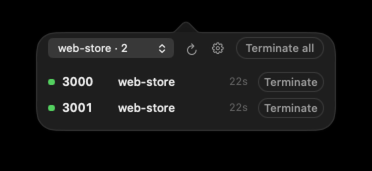
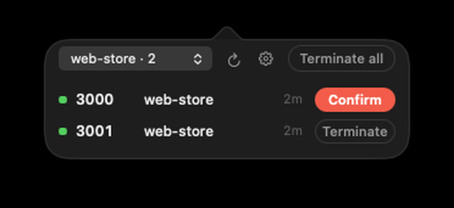
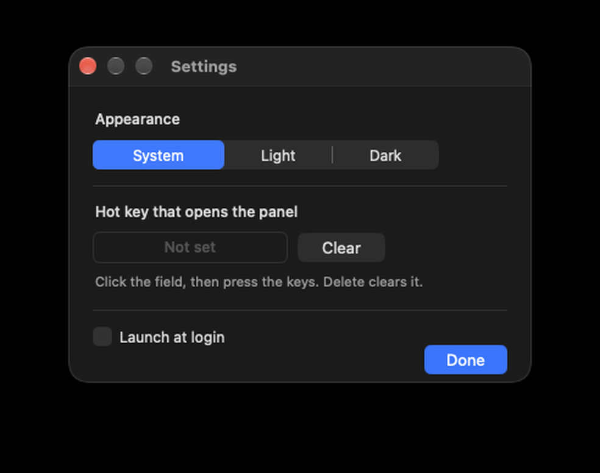

# PortBuddy

A tiny macOS menu bar app that shows which TCP ports your own processes are
listening on — named by the project or app behind each one — and terminates
what you point at. It replaces typing `lsof -i :3000` and then `kill`.

**[中文说明在这里](README.zh-CN.md)**

<p>
  
  
</p>

<p>
  
</p>

The interface is bilingual: it follows the system language (English or Chinese).

## What you get

- **Longest running first.** Rows are ordered by how long the process has been
  up, not by port number: the server you started three days ago sits at the top
  where you will find it, the one from a minute ago at the bottom.
- **Every port your own processes are listening on**, named by the project
  folder or app behind it — `shop-web`, `api`, `Docker` — instead of a bare
  `python3.14`. The name comes from the `.app` bundle the process lives in,
  else the directory it was started from, else the binary name.
- **A filter for one project at a time.** One dev server per port means the same
  project shows up several times. Click a row's name to narrow the list to it —
  click that name again, or pick **全部 / All** in the header popup, to clear it.
  The popup carries the count per group. The filter lives as long as the app is
  running; a fresh launch starts with everything.
- **System daemons are not listed at all.** ControlCenter, rapportd and the rest
  cannot be terminated without root, so they never take up a row.
- **Terminate (终止)**: the first click arms the capsule and turns it red
  (`确认` / Confirm), the second click sends `SIGTERM`. Hold ⌥ on the second click to
  send `SIGKILL`. Nothing modal, and it falls back to idle by itself after three
  seconds.
- **Terminate all (全部终止)**: the same two-step, applied to every row on
  screen — so with a filter active, to that project.
- **How long each process has been up** sits at the end of the row (`1h2m`,
  `4m`).
- **A global hot key** (gear icon or right-click → Settings) opens the panel
  from anywhere. The panel deliberately does **not** take keyboard focus: it
  never pulls you out of what you were typing. Settings also carries the
  appearance (System / Light / Dark) and a launch-at-login switch.
- **Click a port number** to copy `http://localhost:<port>`.
- The menu bar badge counts your listening ports.

No sudo, no background daemon, no dependencies, no network access.

## Install

Requires macOS 13 or later and the Xcode Command Line Tools (`xcode-select --install`).

```sh
git clone https://github.com/slow-coding/port-buddy.git
cd port-buddy
make            # universal binary (arm64 + x86_64) into build/PortBuddy.app
make install    # copies it to /Applications and registers it with LaunchServices
```

A prebuilt disk image from the Releases page works the same way: open
`PortBuddy-<version>.dmg` and drag `PortBuddy` into `/Applications` (a
`PortBuddy-<version>.zip` is there too, if you prefer unzipping). The app is
ad-hoc signed, not notarised, so the first launch of a downloaded copy needs
right-click → Open.

To start it at login: System Settings → General → Login Items → add PortBuddy.

## Using it

| Action | Result |
| --- | --- |
| Click the menu bar icon | Opens the panel |
| Hot key from Settings | Same panel, from anywhere in macOS |
| Popup in the header | Filter the list to one project or app |
| Click a row's name | Same filter, from the row itself; click it again to clear |
| **终止 / Terminate** | Arms, second click sends `SIGTERM` |
| ⌥ + second click | Sends `SIGKILL` instead |
| **全部终止 / Terminate all** | Arms, second click terminates every row on screen |
| Click a port number | Copies `http://localhost:<port>` |
| Gear icon / right-click → Settings | Appearance, hot key, launch at login |
| Right-click the icon | Refresh, settings, quit |
| ⌘Q while the panel is open | Quits |

The list refreshes every 2 seconds while the panel is open, every 5 seconds
otherwise (the badge keeps counting).

## Command line

```
PortBuddy                        start the menu bar app
PortBuddy --json                 one JSON object per listening socket
PortBuddy --kill 3000            terminate whatever listens on :3000
PortBuddy --kill 3000 --force    send SIGKILL instead of SIGTERM
PortBuddy --kill-all --dry-run   list what "terminate all" would hit
PortBuddy --kill-all             terminate every process listed under "Mine"
PortBuddy --version
```

`--json` is one object per line, ready for `jq`, and unlike the panel it also
reports sockets held by system daemons:

```json
{"port":3000,"pid":40042,"name":"website","command":"python3.14","argv":"python3 -m http.server 3000","cwd":"/Users/me/demo/website","path":"/opt/homebrew/bin/python3.14","uid":501,"system":false,"hosts":["127.0.0.1"]}
```

## What it does not do

- **No UDP.** TCP listeners only.
- **No system daemons in the panel.** They are still in `--json`, but they can
  only be signalled with root, so the panel leaves them out.
- **No other users.** Processes outside your account are not listed and cannot
  be signalled; nothing is ever escalated.
- **No background service.** The hot key is Carbon's `RegisterEventHotKey`,
  which needs no Accessibility permission.
- **No history, no logging, no metrics, no network.**

## How it works

- The socket table comes from `lsof -nP -iTCP -sTCP:LISTEN -Fpcun`; the command
  line from `ps -o pid=,command=`; the executable path and working directory
  from `proc_pidpath()` / `proc_pidinfo(PROC_PIDVNODEPATHINFO)`.
- Rows are named from the app bundle (`…/Google Chrome.app/…` → `Google Chrome`),
  else from the last folder of the working directory (`…/code/shop-web` →
  `shop-web`), else from the binary name. Directories that say nothing —
  home, `/`, temp — are skipped on purpose.
- The filter groups rows by that name; the running time comes from
  `proc_pidinfo(PROC_PIDTBSDINFO)` (start time of the process).
- Termination is `kill(pid, SIGTERM)` or `SIGKILL`, and only ever for processes
  you own that do not live under `/System`, `/usr/libexec`, `/usr/sbin`, `/usr/bin`.

## Development

```
make bundle   # build build/PortBuddy.app
make run      # build and launch
make icon     # regenerate Resources/AppIcon.icns from Sources/PortGlyph.swift
make check    # JSON sanity check on the scanner
make zip      # build/PortBuddy-<version>.zip for a release
make dmg      # build/PortBuddy-<version>.dmg (app + Applications link)
make clean
```

Layout: `Sources/PortScanner.swift` (socket table → rows), `Sources/PortPanel.swift`
(popover content, filter and the two-step terminate button), `Sources/PortGlyph.swift`
(the mark, in the menu bar and on the app icon), `Sources/AppDelegate.swift`
(status item, refresh, actions), `Sources/CLI.swift`, `Sources/L10n.swift`.

The panel can be driven without a mouse, which is how the terminate button is
tested:

```
# opens the popover, clicks the real terminate button twice, checks the socket is gone
python3 -m http.server 8611 &
./build/PortBuddy.app/Contents/MacOS/PortBuddy --selftest-click 8611
```

The settings window and the hot key are on the same footing:

```
./build/PortBuddy.app/Contents/MacOS/PortBuddy --settings    # opens the modal settings window
./build/PortBuddy.app/Contents/MacOS/PortBuddy --hotkey      # sets ⌥⌘P and prints whether Carbon took it
```

Screenshots come from the same door:

```
./build/PortBuddy.app/Contents/MacOS/PortBuddy --show --debug-frame /tmp/f.txt \
    --appearance dark --arm 3000 --filter website
# writes the popover's window id to /tmp/f.txt
screencapture -x -l <window-id> panel.png
```

## License

Apache-2.0. See [LICENSE](LICENSE).
